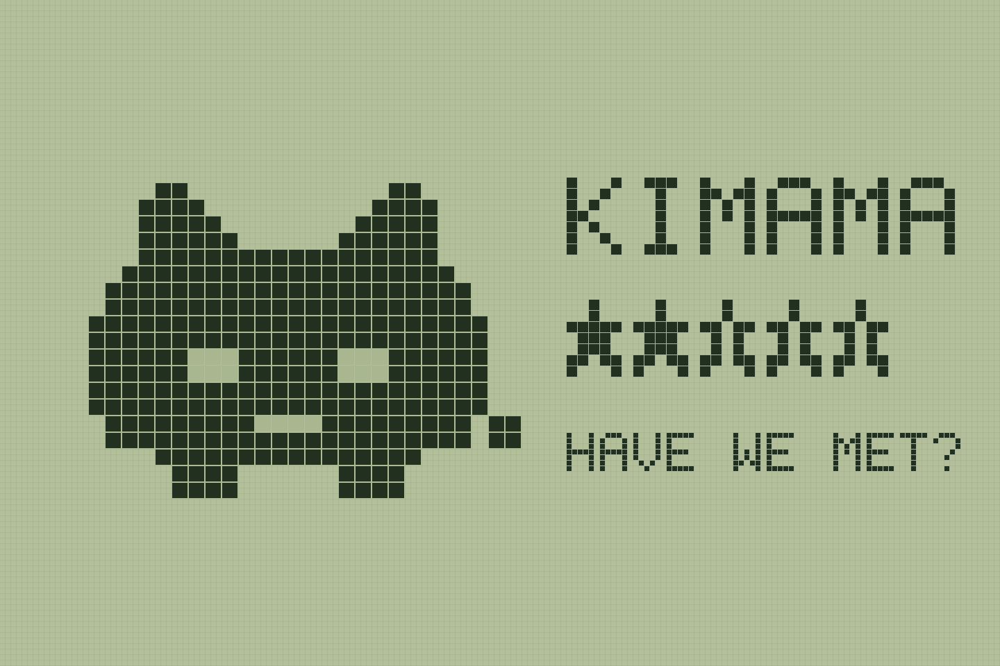
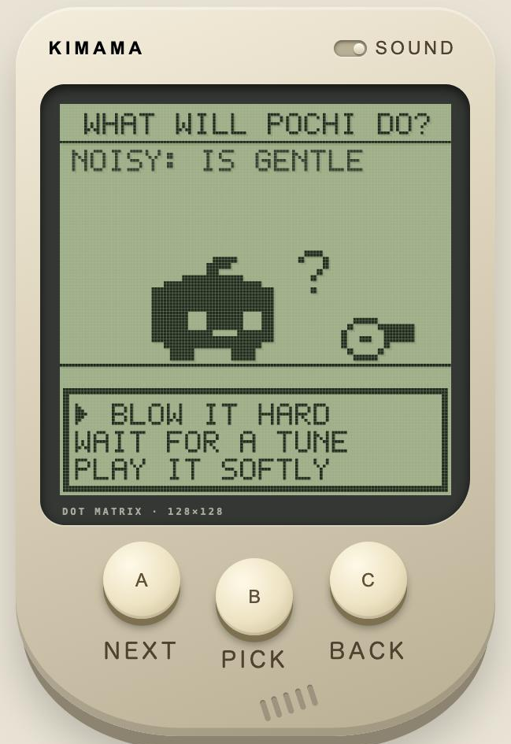
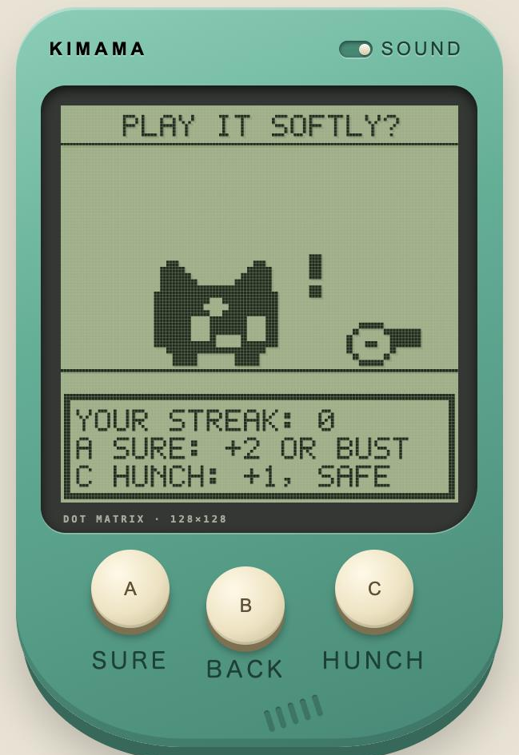
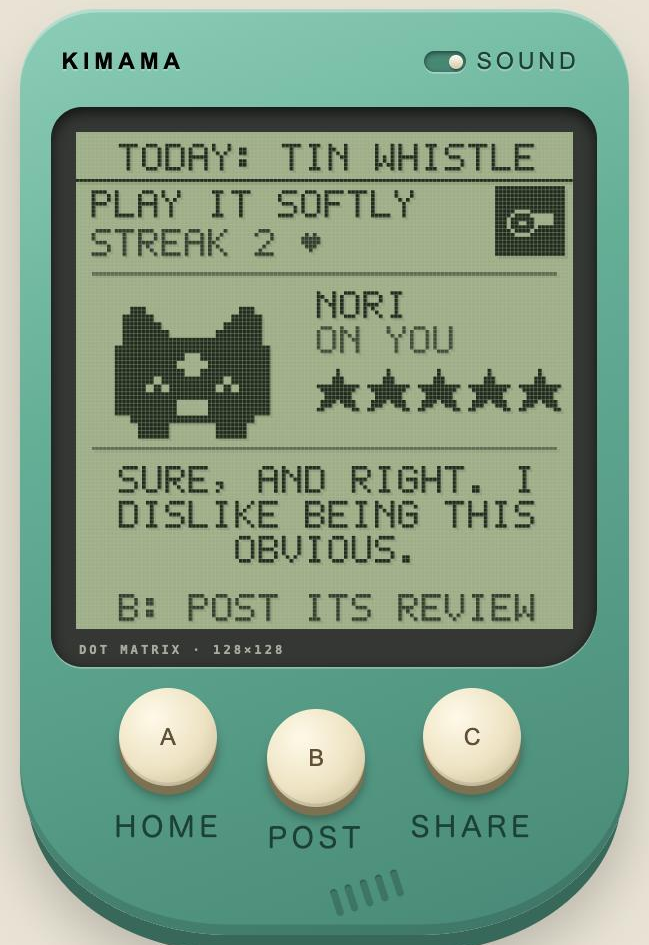
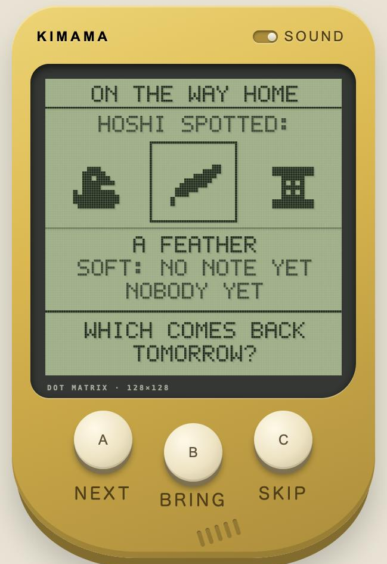
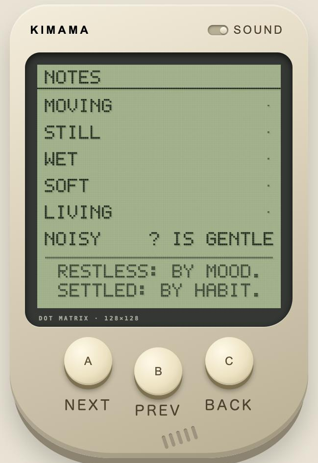
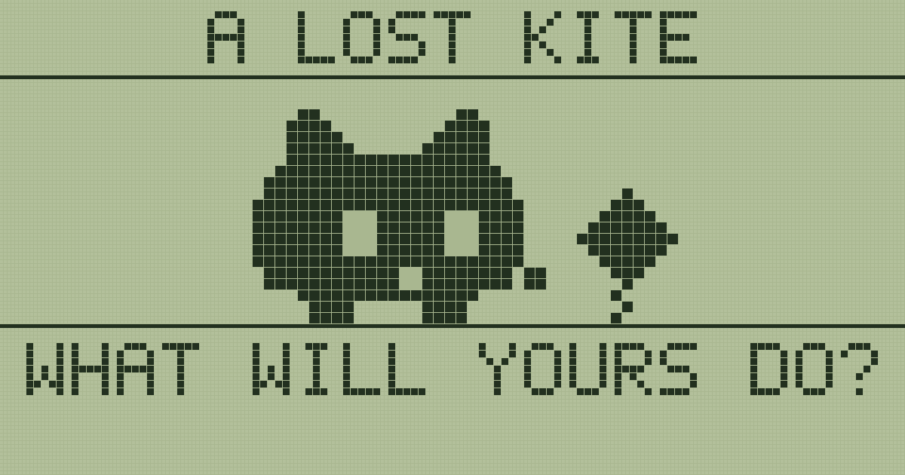
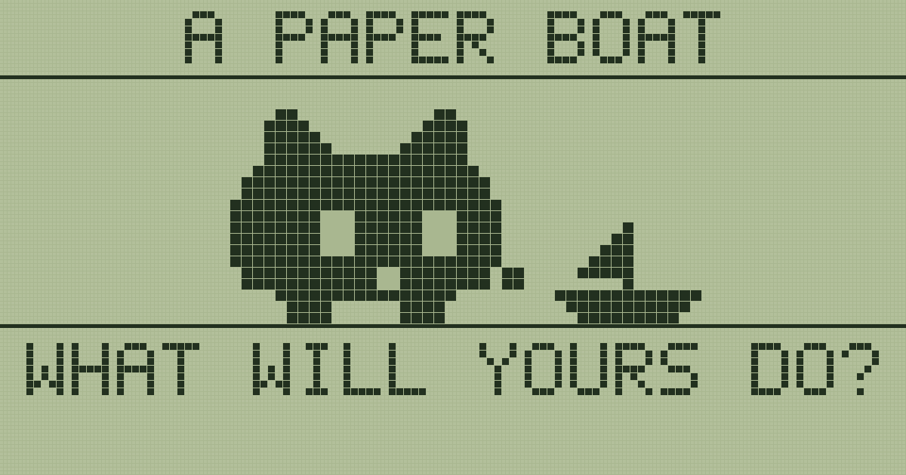
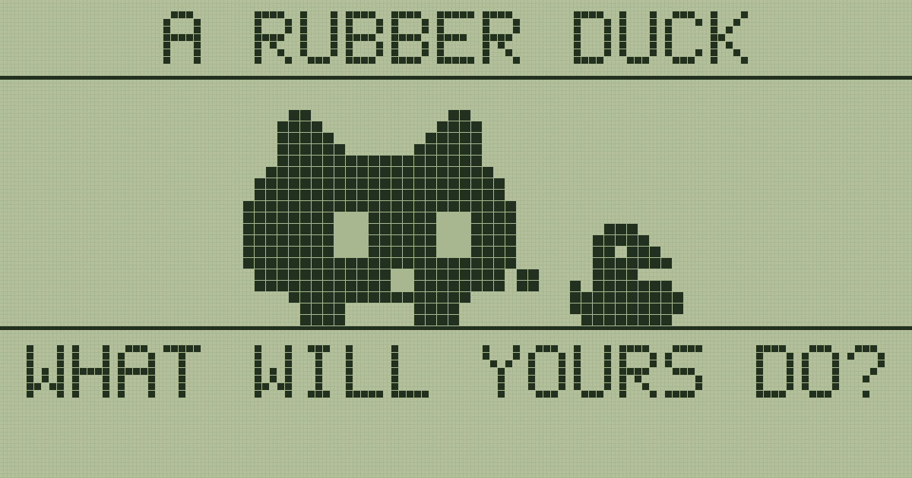

# Kimama



**A little pet that reviews you.** A daily game for Reddit, built on Devvit Web.

**[Play in r/kimama](https://www.reddit.com/r/kimama/)** · [Watch the one-minute demo](https://youtu.be/-tNzPF-PDsI) · [App listing](https://developers.reddit.com/apps/kimama-pet) · [Source](https://github.com/gowtham0992/kimama)

---

Kimama (気まま, "as it pleases") is a pet in a small dot-matrix handheld. Once a
day something turns up outside, the same thing for every pet in the community.
You say what yours will do with it, bet your streak on how sure you are, and it
gives you its verdict: stars out of five, and one line.

> ★★☆☆☆ "You: keep it safe. Me: launch it. Have we met?"

Most daily games end in a score. This one ends in a review, and a review is
something people answer.

## A day with Kimama

| 1. Read it | 2. Bet | 3. Get reviewed | 4. Choose tomorrow |
| :---: | :---: | :---: | :---: |
|  |  |  |  |
| What will it do with a tin whistle? | Sure, or only a hunch? | Stars, and one line about you. | The most-picked thing comes back for everyone. |

It takes about two minutes. There is a new find every day at 00:00 UTC.

## How to play

1. **Hatch.** Open the day's post and press once. Your pet has a name, a shape
   and a temperament of its own: bold, gentle or shy.
2. **Something turns up.** A paper boat, an odd sock, a bumblebee. Thirty
   objects in rotation, one a day.
3. **Read your pet.** Three signs decide what it does, and all three are on the
   screen before you answer.
4. **Pick one of three answers.** They carry no labels and come in a different
   order each day. Telling the bold one from the careful one from the wary one
   is part of the read.
5. **Bet your streak.** Then watch what it does.
6. **Read your review.** Post it to the thread with your reply, or don't.
7. **Choose tomorrow.** On the way home your pet spots three things. Pick the
   one it should bring back. Whatever the community picks most is tomorrow's
   find, for everyone.

## The read: three signs, nothing hidden

| Sign | Where you see it | What it tells you |
| --- | --- | --- |
| **Mood** | How the pet stands: it leans in, circles carefully, or hangs back | What it feels like doing today |
| **Habit** | Your notes, one line for each sort of thing | What it always does with moving, still, wet, soft, living or noisy things |
| **Mind** | The story says "It is restless today" or "It is settled today" | Restless, it goes by its mood. Settled, it keeps to its habit |

Nothing is decided out of sight. A wrong guess is a misread, or a note you do
not have yet, and the end card says which sign decided.

The egg comes with a note of one habit, so the first find is already the whole
game. A new note is written the first time your pet meets a sort of thing.
Once it knows you, about one day in five it says "It is in two minds today".
That is the only chance in the game, and it is announced before you bet.



## The bet

| | Right | Wrong |
| --- | --- | --- |
| **Hunch** | Streak +1 | Streak kept, one star lost |
| **Sure** | Streak +2, an extra star | Streak lost, one star, and its worst line |

Miss one day and your streak is kept. Miss two and it starts again.

## Made for a community

- **Today's pets choose tomorrow's find.** Every pet spots the same three
  things on the way home, and every owner picks one. The most-picked comes back
  at midnight for the whole community. The new post says how many chose it, and
  your pet remembers whether the street agreed with it.
- **One object, every pet.** Everyone's pet meets the same thing, so the
  comments compare like with like.
- **Your review, your reply.** Posting takes two presses. You pick a one-word
  answer first ("Rude." "Fair." "Frame it."), and the review goes up as a reply
  under the day's pinned comment. You can take it down again.
- **Flair.** Posting sets your flair to `rated ★★☆☆☆ by <pet>`.
- **Yesterday's results.** Each new post opens with a pinned comment: how the
  pets split, the average rating they gave their humans, and the harshest and
  kindest review. Pets are named. Owners never are.
- **The window.** Other players' pets walk past yours, showing how they rated
  their own humans.
- **Shared links.** A link from the share sheet opens with the sender's verdict
  on the card, marked "sent to you".

## Tomorrow is chosen today


The three things on the path are never today's sort of thing, never anything
found in the last two weeks, and always three different sorts. So the choice is
a real one: a noisy day, a soft day or a moving day. Your notes say which sorts
your pet has met, so you can steer toward the habit you still need to learn.

The next morning the story says it: "Dango picked this one yesterday, and the
street agreed." Or: "Hoshi wanted the feather. The street chose this."

A tie goes to whichever was first on the path. If nobody picks, the first on the
path comes back anyway, so the game never waits on a quiet day.

## Thirty finds





Six sorts of thing, five of each, and the community decides the order. Every object has its own answers and its own
endings, with separate ones for bold and shy pets: 150 outcomes in all. A stamp
card keeps one square for each find.

## Between finds

The pet lives without you. It plays, naps, sulks, looks out of the window and
leaves droppings. You can feed it, pet it, tell it no and clean up after it.

Care changes the read: a pet that has been fussed over is braver, and one that
has been told off hangs back. What you did today also decides its stars and
which line it says. There are about seventy review lines in three voices: blunt,
kind and devastating, and shy.

If something is costing you a star, the review says what and how to fix it:
"Feed it: +2 ★".

## What it asks, and what it keeps

- **Posting** is never automatic and never needed to play. It takes two
  presses, says your username will be on it, and can be undone.
- **Joining the community** is asked once, as its own question.
- **Notifications:** none. The game sends nothing.
- **Stored:** your pet (name, needs, notes, streak) under your Reddit account
  id. A pet is deleted thirty days after it last changed. Daily tallies are
  deleted after three days.
- No adverts, no payments, no outside services.

## For moderators

Kimama is built for one community, its own. Installing it creates the first
daily post, and nothing needs configuring.

- **Every day at 00:00 UTC** the app counts yesterday's picks, makes the
  winner today's find, creates the day's post, pins it, unpins the one before,
  and pins one comment under it with yesterday's results.
- **A post flair named "Daily find"**, if the community has one, is put on each
  daily post.
- **Menu: "Create today's Kimama post."** Makes today's post if it is missing.
  Safe to press twice.

## Under the hood

- **Devvit Web.** React on the client, Hono on the server. Redis holds each
  pet. The scheduler makes the daily post. Reddit's comment, flair and share
  APIs carry the verdict into the thread.
- **The screen** is a 128×128 one-colour dot matrix drawn as SVG. Every sprite,
  letter and picture is written as dots in the source.
- **Three buttons do everything, and so does a finger.** Every screen also has
  a spoken description for screen readers.
- **Nothing is generated while the game runs.** Every sentence, answer and
  review line is fixed in the source.
- **112 tests** cover the read, the wording of the answers, the streak and the
  bet, the review rules, line lengths, the daily results and the vote for
  tomorrow, including the day change.

```bash
npm install
```

```bash
npm run check
```

```bash
npm run dev
```

`npm run check` runs the type checks, the tests and the build. `npm run dev`
serves the game on your own machine, with pets kept in a local file.

| Path | What is there |
| --- | --- |
| `src/shared/` | The pet, the daily read, the answers and endings, the reviews, the vote for tomorrow |
| `src/client/pet.tsx` | The handheld: buttons, screens, sound |
| `src/client/px.tsx`, `stage.tsx` | The dot-matrix drawing and the room |
| `src/client/pet-splash.tsx` | The card shown in the feed |
| `src/server/index.ts` | The server: pet state, the daily post, comments, flair |
| `scripts/` | Draws the brand and share pictures from the game's own sprites |
| `tests/` | The test suite |

The repository also holds an earlier prototype, a snack-guessing puzzle that
the pet grew out of. Nothing in the daily post reaches it.

## How it was made

Kimama was made by one person for Reddit's Game of the Day hackathon, working
with AI coding tools. Claude Code wrote most of the code and placed the sprites
as dot patterns in the source. Codex played the game on Reddit with test
accounts and reported what broke. Gemini gave outside reviews.
